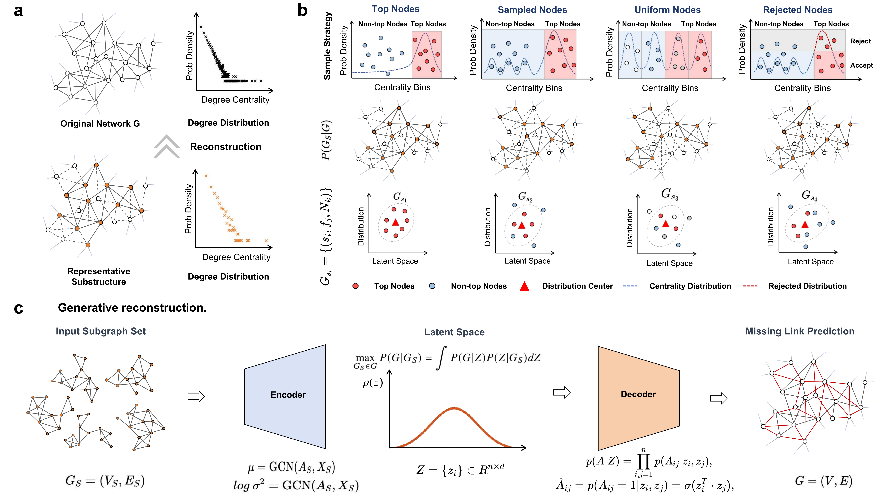

# Beyond Network Centrality: Uncertainty Induces More Representative Subgraphs

This repository contains the implementation, datasets, and experimental notebooks for the paper "Beyond Network Centrality: Uncertainty Induces More Representative Subgraphs".

## Abstract

Identifying small subgraphs that faithfully represent the structure of much larger networks is a fundamental problem in network sciences. Structural information is often assumed to be concentrated around highly central nodes, yet individually important nodes need not form a collectively representative subgraph. We show that deterministic top-centrality selection can overconcentrate sampling on hubs and dense cores, producing induced subgraphs that deviate from characteristic network-wide structure. We introduce a centrality-probabilistic sampling framework that selects nodes stochastically according to centrality-derived probabilities and evaluate the resulting subgraphs using structure-based criteria. Across real-world citation, collaboration, biological networks, and synthetic networks, probabilistically sampled subgraphs generally achieve stronger link-prediction fidelity than top-centrality alternatives under the same node budget, with degree-guided, coreness-guided, and PageRank-guided sampling showing particularly robust performance. These subgraphs also more closely preserve degree distributions, sparsity, degree heterogeneity, and clustering structure, while retaining strong structure fidelity with only 5%-20% of the original nodes. Our results reveal that structural representativeness is not confined to network hubs, but emerges from a balanced sampling of central and peripheral nodes, providing a general principle for extracting informative substructures from large complex networks.

<p align="center">

</p>

## Project Structure

- **`CEVAE/`**: Main implementation code including VAE model, training loop, and centrality-based sampling methods
- **`data/`**: Network datasets (Citation networks: Cora, CiteSeer, PubMed; Collaboration: CA-CondMat, Cit-HepPh; Biological: Amazon, Fly, and more)
- **`Figure1/`**: Notebooks for generating main experimental results and comparison plots
- **`Figure2/`**: Notebooks for baseline property analysis
- **`Figure3/`**: Notebooks for correlation analysis
- **`SI/`**: Supplementary information and additional analyses

## Requirements

To run the code, install the packages from `requirements.txt`. We recommend creating a conda environment:

```bash
conda create --name CEVAE --no-default-packages
conda activate CEVAE
```

Then install dependencies (inside the `CEVAE` directory):


```bash
pip install -r requirements.txt
```

## Key Modules (CEVAE/)

- **`model.py`**: VAE-based graph autoencoder implementation
- **`layers.py`**: Graph neural network layers
- **`train.py`**: Training pipeline for link prediction tasks
- **`centrality.py`**: Centrality measure calculations
- **`data_sampleprob.py`**: Probabilistic sampling based on centrality scores
- **`data_generator.py`**: Data loading and preprocessing
- **`evaluation.py`**: Evaluation metrics and result analysis
- **`preprocessing.py`**: Network data preprocessing utilities

## Datasets

The `data/` directory contains multiple network datasets:

- **Citation Networks**: Cora, CiteSeer, PubMed
- **Collaboration Networks**: CA-CondMat, Cit-HepPh
- **Biological Networks**: Amazon, Fly (Drosophila brain networks)

## Usage

To run experiments, use the training script with various centrality measures and sampling methods:

```bash
cd CEVAE
python train.py --model=gcn_vae --dataset=cora --task=link_prediction \
                 --fastgae=rn --measure=pagerank --nb_node_samples=500 \
                 --learning_rate=0.008 --alpha=1.0
```

### Available Options

- **Centrality Measures**: `degree`, `betweenness`, `closeness`, `core`, `pagerank`, `eigenvector`, `gravitydegree`, `gravitycore`, `gravitybetweenness`, `gravitycloseness`, `gravitypagerank`
- **Sampling Methods**: `sn` (centrality-prob sampling), `tn` (top-k nodes sampling), `rn` (rejected sampling), `un` (random sampling)
- **Datasets**: `cora`, `citeseer`, `pubmed`, etc.

Use `python train.py --help` for all available command-line options.

## Experiments & Visualizations

Jupyter notebooks in `Figure1/`, `Figure2/`, `Figure3/`, and `SI/` folders reproduce the paper's main results, including link prediction performance, property preservation analysis, and correlation studies.
